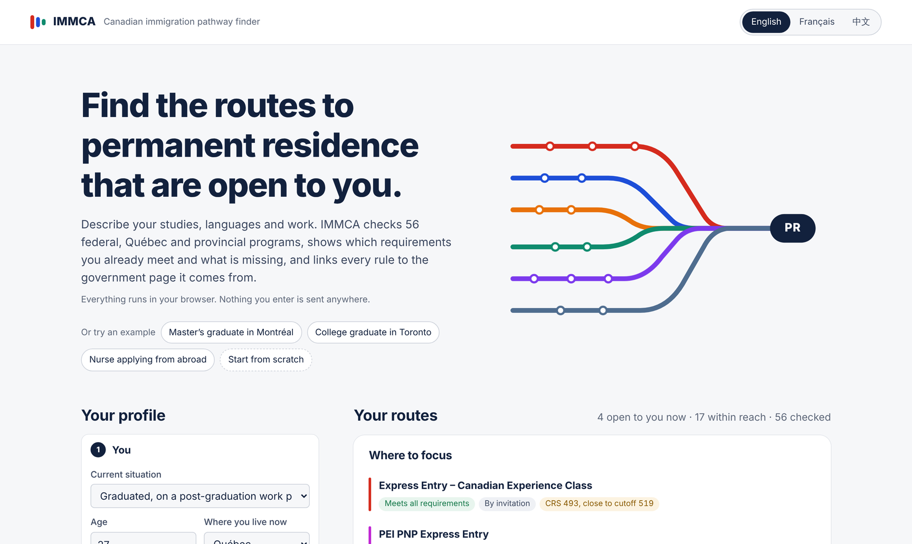
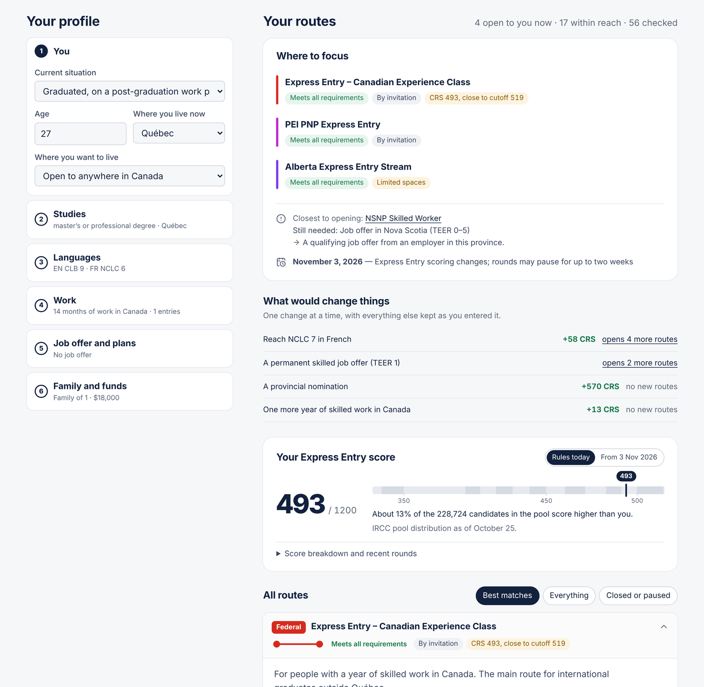
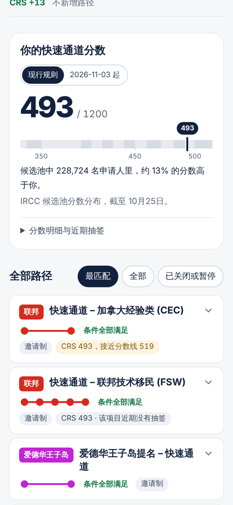
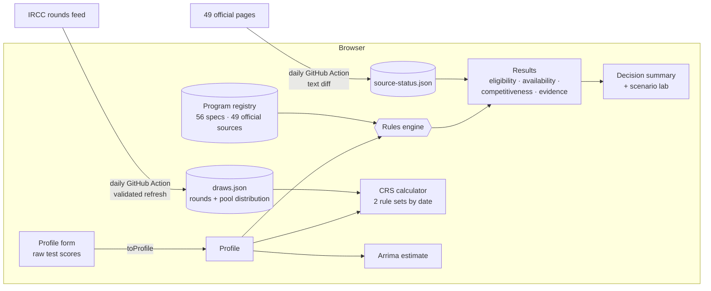

<div align="center">

# IMMCA — Canadian Immigration Pathway Finder

**Which routes to Canadian permanent residence are open to you — and what is still missing — with every rule linked to the government page it comes from.**

### [**Open the live site → ellensyuu.github.io/IMMCA**](https://ellensyuu.github.io/IMMCA/)

[](https://github.com/EllenSyuu/IMMCA/actions/workflows/ci.yml)
[](https://github.com/EllenSyuu/IMMCA/actions/workflows/pages.yml)
[](https://github.com/EllenSyuu/IMMCA/actions/workflows/daily.yml)




</div>

## Why this exists

For an international student, the hardest part of planning permanent residence is not any single rule — it is that the rules are spread across **fourteen governments** and change every few months. Between 2024 and 2026 alone: job-offer points were removed from Express Entry and come back in a new form on **3 November 2026**; Ontario closed all eight of its nominee streams and replaced them with one; British Columbia, Manitoba and Saskatchewan closed or narrowed their graduate streams; Québec abolished the PEQ, then reopened it for a single four-month window that closes on **31 October 2026**.

IMMCA turns that into one question: *given my studies, languages and work, which routes are open to me today, which are within reach, and what would close the gap?*

## What it does

- **Screens 56 programs** — Express Entry (CEC, FSW, FST and every 2026 category draw), the Atlantic, rural and francophone pilots, Québec's PSTQ and PEQ, and the nominee streams of all twelve provinces and territories that run one.
- **Answers first.** A short summary names the routes worth pursuing, the single requirement blocking the nearest one, and the dates that matter to you.
- **Keeps four questions apart** that a single green light would blur: do you *meet the rules*, is the program *open* (or are its 2026 spaces nearly gone), how *competitive* are you where an official cutoff exists, and how *solid is the evidence* behind the rule (verified, approximated, unconfirmed, or the official page changed and is under review).
- **Shows each program as a transit line.** Every requirement is a station: filled when you meet it, hollow when you don't, dashed when it can't be judged from a form (a community recommendation, a regulator's licence). Open a line to see each station, how to close each gap, and the official sources.
- **Scenario lab.** One change at a time — NCLC 7 in French, another year of Canadian work, a job offer, a nomination — with the CRS effect *and* the routes it would open.
- **Calculates your CRS under both rule sets** — the grid in force today and the Labour Market Integration factor that starts on 3 November 2026.
- **Places your score in the real Express Entry pool** using IRCC's published distribution of 228,724 candidates, refreshed daily from IRCC's own feed.
- **Estimates your Arrima score** for Québec's PSTQ from the ministry's 1,400-point grid.
- **Converts raw test scores** (IELTS, CELPIP, PTE Core, TEF Canada on both of its scales, TCF Canada) to CLB/NCLC and to the Québec French scale, so people can type what is on their result sheet.
- **Runs entirely in the browser**, in English, French or Chinese. Nothing anyone types leaves their device.

<table>
<tr>
<td width="68%"></td>
<td width="32%"></td>
</tr>
</table>

## How it works



### Rules as data

Each program is a declarative spec built from a small set of requirement combinators, so a policy change is a one-line data change rather than new branching logic. This is the whole definition of the Canadian Experience Class:

```ts
{
  id: 'ee-cec',
  jurisdiction: 'federal',
  kind: 'express-entry',
  status: 'invitation-only',
  criteria: [
    workExperience({ months: 12, teers: [0, 1, 2, 3], inCanada: true, withinMonths: 36,
                     excludeStudentWork: true, excludeSelfEmployed: true }),
    custom('check.cecLanguage', cecLanguageOk),   // CLB 7 for TEER 0–1 work, CLB 5 for TEER 2–3
  ],
  points: crsPoints('cec'),                        // shows your CRS against the latest CEC cutoff
  sources: [{ url: 'https://www.canada.ca/…/canadian-experience-class.html', verified: '2026-10-27' }],
}
```

Combinators include `workExperience` (time windows, TEER, province, NOC, student-work exclusion), `jobOffer`, `canadianGraduate`, `minLanguage`, `minEducation`, `settlementFunds` (with waivers), `anyOf` (alternative routes, showing the closest one) and `note` (requirements a screener can't judge, shown honestly as unknown). Every check returns a message key rather than text, so one evaluation renders in three languages.

### Freshness and time

Immigration rules have dates, so the engine does too:

- **Date-switched scoring.** `computeCrs(profile, date)` applies the 2025-03-25 grid before 3 November 2026 and the Labour Market Integration factor from that day, using IRCC's list of 186 high-wage occupations.
- **Closing dates.** A program with `closesOn` (the PEQ: 31 October 2026) turns into *closed* by itself the next day. The PEQ's snapshot rule — the diploma must already have existed on 19 November 2025 — is evaluated against the current date.
- **Daily, automatic updates — no push needed.** Every morning [`daily.yml`](.github/workflows/daily.yml) runs on GitHub:
  - [`scripts/refresh-draws.mjs`](scripts/refresh-draws.mjs) pulls IRCC's rounds feed, validates its shape and checks that the pool distribution adds up before writing anything; a changed feed fails loudly instead of shipping bad numbers.
  - [`scripts/check-sources.ts`](scripts/check-sources.ts) fetches every official page a rule cites, reduces it to readable text and compares it with the text the rule was verified against. It never rewrites a rule by itself: a changed page marks the program *Official page changed* on the site and opens a GitHub issue, and the commit shows the exact text diff under `monitor/snapshots/`.
  - The site is rebuilt and redeployed, so the "last checked" date in the footer is always today's.

### Honest about uncertainty

Every program carries the official URLs it was checked against and the date. Where an official page could not be read in full, or two official pages disagree (Québec's PEQ notice and stream page differ on whether workers need a Québec diploma), the program says so in plain words instead of guessing. The full evidence log, including what could *not* be verified, is in [`docs/research/`](docs/research/).

Before release, every spec was audited line by line against that log by a reviewer that had not written the code; each finding (for example, trade-NOC limits for the Federal Skilled Trades, the FSW 67-point grid for Express Entry-linked streams, the PEQ's snapshot date for work experience) is pinned by a regression test in [`tests/audit.test.ts`](tests/audit.test.ts).

## Coverage

| Jurisdiction | Programs | Notes |
|---|---:|---|
| Federal | 17 | Express Entry programs and all 2026 categories, AIP, RCIP, FCIP, PGWP bridge |
| Québec | 6 | PSTQ streams 1–3, PEQ reopening (graduates, workers), ended pilots |
| Ontario | 3 | Ontario Workforce Priority (TEER 0–3 and TEER 4–5 rules); closed Masters/PhD streams for context |
| British Columbia | 4 | Targeted Care / Build / Innovate draws; graduate streams closed |
| Alberta | 5 | Worker EOI pool streams, Accelerated Tech, health care, rural renewal |
| Saskatchewan | 5 | Students, Tech and Health Talent, job-offer and in-demand categories |
| Manitoba | 3 | Skilled Worker in Manitoba, Graduate Internship; Career Employment closed |
| New Brunswick | 4 | NB Graduates, NB Experience, Express Entry, francophone initiative |
| Nova Scotia | 3 | Skilled Worker, Nova Scotia Graduate, Express Entry |
| Prince Edward Island | 2 | International Graduates, Express Entry |
| Newfoundland and Labrador | 2 | International Graduate, Express Entry Skilled Worker |
| Yukon, Northwest Territories | 2 | Employer-led streams with yearly intake windows |

Nunavut has no nominee program. Business and investor streams are out of scope.

## Running it

```bash
npm install
npm run dev            # http://localhost:5173
npm test               # 64 tests: CRS tables, conversions, time windows, programs, audit regressions, monitor, translations
npm run build          # static site in dist/ — deployed to GitHub Pages on every push to main
npm run refresh:draws  # pull the latest Express Entry rounds from IRCC
npm run sources:check  # check every official page for changes
```

```
src/
  engine/            pure TypeScript, no UI: types, criteria combinators, evaluation, CRS, test-score conversion
  data/
    programs/        federal.ts · quebec.ts · east.ts · west.ts — one spec per program, with sources
    highWage.ts      NOC tiers for the 2026-11-03 CRS factor
    insights.ts      the four dimensions, decision summary and scenario lab
    draws.json       Express Entry rounds and pool distribution (refreshed daily)
    source-status.json  state of every official page (updated daily)
  i18n/              en · fr · zh dictionaries (a test enforces identical keys and placeholders)
  ui/                React components: profile form, score panel, route cards
tests/               Vitest suites
docs/research/       evidence log for every rule
```

To update a rule when a government changes it, see [CONTRIBUTING.md](CONTRIBUTING.md).

## Privacy

IMMCA has no server, no analytics and no accounts. The profile is computed in the browser and kept only in that browser's local storage so the form survives a reload; clearing site data removes it.

## Disclaimer

IMMCA is an independent, open-source screener. It is not legal advice and is not affiliated with Immigration, Refugees and Citizenship Canada, the Ministère de l'Immigration du Québec or any provincial government. Meeting minimum requirements does not guarantee an invitation, and rules change often. Always confirm on the official page, and consider a licensed immigration consultant (RCIC) or lawyer for your own case.

## Citation and licence

Released under the [Apache License 2.0](LICENSE). If you use the engine or the rule data, please cite it using [CITATION.cff](CITATION.cff).
