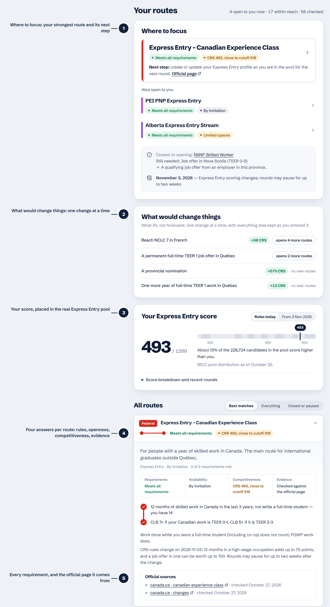
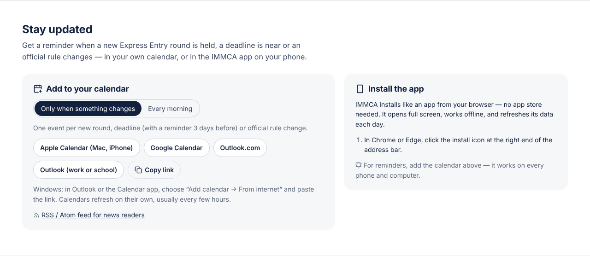
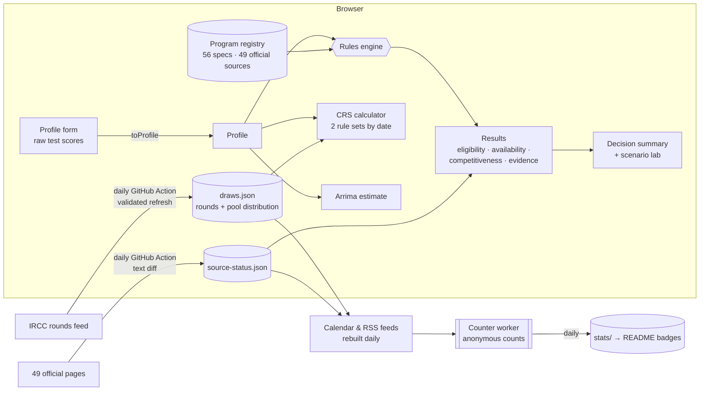

<div align="center">

<a href="https://ellensyuu.github.io/IMMCA/">
  <picture>
    <source media="(prefers-color-scheme: dark)" srcset="docs/brand/cover-dark.png">
    
  </picture>
</a>

<h3>
  <a href="https://ellensyuu.github.io/IMMCA/">Open the app</a>
  <span> · </span>
  <a href="https://ellensyuu.github.io/IMMCA/#stay-updated">Subscribe</a>
  <span> · </span>
  <a href="https://ellensyuu.github.io/IMMCA/#stay-updated">Install</a>
  <span> · </span>
  <a href="docs/research/">Evidence log</a>
  <span> · </span>
  <a href="PRIVACY.md">Privacy</a>
</h3>

**Tell it your studies, languages and work. It tells you which routes to Canadian PR are open to you today,<br>which are within reach, and the one thing that would close the gap, with every rule linked to the government page it comes from.**

[](PRIVACY.md)
[](https://ellensyuu.github.io/IMMCA/#stay-updated)
[](https://ellensyuu.github.io/IMMCA/#stay-updated)

[](https://github.com/EllenSyuu/IMMCA/actions/workflows/ci.yml)
[](https://github.com/EllenSyuu/IMMCA/actions/workflows/daily.yml)
[](https://github.com/EllenSyuu/IMMCA/actions/workflows/pages.yml)


**English** · [Français](docs/readme/README.fr.md) · [简体中文](docs/readme/README.zh-CN.md)

<br>


</div>

<br>

## Why IMMCA

For an international student, the hardest part of planning permanent residence is not any single rule. It is that the rules are spread across **fourteen governments** and change every few months. Between 2024 and 2026 alone, job-offer points left Express Entry and come back in a new form on **3 November 2026**; Ontario closed all eight of its nominee streams and replaced them with one; British Columbia, Manitoba and Saskatchewan closed or narrowed their graduate streams; Québec abolished the PEQ, then reopened it for a four-month window ending **31 October 2026**.

- **One map instead of fourteen websites.** 56 programs: Express Entry and every 2026 category, the Atlantic, rural and francophone pilots, Québec's PSTQ and PEQ, and the nominee streams of every province and territory that runs one.
- **An answer, not a checklist.** It starts with where to focus, the one requirement blocking your nearest route, and the dates that matter to you.
- **Monitored every day, changed by review.** Each morning a GitHub Action pulls IRCC's latest rounds, re-reads all 49 official pages the rules cite, and redeploys the site. A changed page is flagged on the site and opened as an issue; the rule itself is only updated after a person has read the change and the tests pass.
- **Honest about what it doesn't know.** Every rule says how solid its evidence is. A requirement a form can't judge (a community recommendation, a regulator's licence) is shown as *to confirm*, never counted as met.
- **Private by design.** It runs entirely in your browser: no accounts, no cookies, and nothing you type is sent anywhere.
- **In your language.** English, Français and 中文, switchable at the top of the page, in the app and in the calendar feeds.

## See it in action

<div align="center">

</div>

## Anatomy of a result

<div align="center">

</div>

<details>
<summary>The same page in 中文 and Français</summary>
<br>
<table>
<tr>
<td width="50%"></td>
<td width="50%"></td>
</tr>
</table>
</details>

1. **Where to focus.** Your strongest route and the next step towards it, the other routes open to you, the closest one that is not open yet and what it still needs, and the next date that affects you.
2. **What would change things.** One change at a time (NCLC 7 in French, another year of Canadian work, a job offer, a nomination), showing both the CRS gain *and* the routes it would open.
3. **Your score in the real pool.** Your CRS under today's grid and under the 3 November 2026 rules, placed in IRCC's published distribution of 228,724 candidates.
4. **Four answers per route,** kept apart instead of blurred into one green light: do you *meet the rules*, is the program *open* (or are its 2026 spaces nearly gone), how *competitive* are you where an official cutoff exists, and how *solid is the evidence*.
5. **Every requirement, with its source.** Each program is a transit line and each requirement a station: filled when you meet it, hollow when you don't, dashed when a form can't judge it. Open it to see how to close each gap and the official pages it was checked against.

## Features

| | |
|---|---|
| **Quick check or full profile** | Nine questions for a first answer, with its assumptions stated; the full profile takes exact test scores, every job, offers and family |
| **Eligibility screener** | 56 federal, Québec and provincial programs, ranked into open / within reach / closed |
| **CRS calculator** | Both rule sets, switched by date, including the Labour Market Integration factor and its 186 high-wage occupations |
| **Arrima estimate** | Québec PSTQ score from the ministry's 1,400-point grid |
| **Test-score conversion** | IELTS, CELPIP, PTE Core, TEF Canada (both scales) and TCF Canada to CLB/NCLC, so you type what is on your result sheet |
| **Calendar subscriptions** | Apple Calendar, Google Calendar, Outlook (Windows, web, work accounts): every new round, deadline (reminder 3 days before) and rule change, or a daily digest. Also RSS/Atom |
| **Installable app** | iPhone, Android, Mac and Windows straight from the browser: full screen, works offline |
| **Daily self-update** | IRCC feed refresh, official-page monitoring with text diffs, automatic redeploy |
| **Open usage stats** | Visits, subscriptions and installs counted by IMMCA's own open-source counter, published daily in [`stats/`](stats/) |

<div align="center">

</div>

## How it works



### Rules as data

Each program is a declarative spec built from a small set of requirement combinators, so a policy change is a one-line data change rather than new branching logic. This is the whole definition of the Canadian Experience Class:

```ts
{
  id: 'ee-cec',
  jurisdiction: 'federal',
  kind: 'express-entry',
  status: 'invitation-only',
  criteria: [
    workExperience({ months: 12, teers: [0, 1, 2, 3], inCanada: true, withinMonths: 36,
                     excludeStudentWork: true, excludeSelfEmployed: true }),
    custom('check.cecLanguage', cecLanguageOk),   // CLB 7 for TEER 0–1 work, CLB 5 for TEER 2–3
  ],
  points: crsPoints('cec'),                        // shows your CRS against the latest CEC cutoff
  sources: [{ url: 'https://www.canada.ca/…/canadian-experience-class.html', verified: '2026-10-27' }],
}
```

Combinators include `workExperience` (time windows, TEER, province, NOC, student-work exclusion), `jobOffer`, `canadianGraduate`, `minLanguage`, `minEducation`, `settlementFunds` (with waivers), `anyOf` (alternative routes, showing the closest one) and `note` (requirements a screener can't judge, shown honestly as unknown). Every check returns a message key rather than text, so one evaluation renders in three languages.

### Freshness and time

Immigration rules have dates, so the engine does too:

- **Date-switched scoring.** `computeCrs(profile, date)` applies the 2025-03-25 grid before 3 November 2026 and the Labour Market Integration factor from that day, using IRCC's list of 186 high-wage occupations.
- **Closing dates.** A program with `closesOn` (the PEQ: 31 October 2026) turns into *closed* by itself the next day. The PEQ's snapshot rule — the diploma must already have existed on 19 November 2025 — is evaluated against the current date.
- **Daily, automatic updates — no push needed.** Every morning [`daily.yml`](.github/workflows/daily.yml) runs on GitHub:
  - [`scripts/refresh-draws.mjs`](scripts/refresh-draws.mjs) pulls IRCC's rounds feed, validates its shape and checks that the pool distribution adds up before writing anything; a changed feed fails loudly instead of shipping bad numbers.
  - [`scripts/check-sources.ts`](scripts/check-sources.ts) fetches every official page a rule cites, reduces it to readable text and compares it with the text the rule was verified against. It never rewrites a rule by itself: a changed page marks the program *Official page changed* on the site and opens a GitHub issue, and the commit shows the exact text diff under `monitor/snapshots/`.
  - The site is rebuilt and redeployed, so the "last checked" date in the footer is always today's.

### Honest about uncertainty

Every program carries the official URLs it was checked against and the date. Where an official page could not be read in full, or two official pages disagree (Québec's PEQ notice and stream page differ on whether workers need a Québec diploma), the program says so in plain words instead of guessing. The full evidence log, including what could *not* be verified, is in [`docs/research/`](docs/research/).

Before release, every spec was audited line by line against that log by a reviewer that had not written the code; each finding (for example, trade-NOC limits for the Federal Skilled Trades, the FSW 67-point grid for Express Entry-linked streams, the PEQ's snapshot date for work experience) is pinned by a regression test in [`tests/audit.test.ts`](tests/audit.test.ts).

## Coverage

| Jurisdiction | Programs | Notes |
|---|---:|---|
| Federal | 17 | Express Entry programs and all 2026 categories, AIP, RCIP, FCIP, PGWP bridge |
| Québec | 6 | PSTQ streams 1–3, PEQ reopening (graduates, workers), ended pilots |
| Ontario | 3 | Ontario Workforce Priority (TEER 0–3 and TEER 4–5 rules); closed Masters/PhD streams for context |
| British Columbia | 4 | Targeted Care / Build / Innovate draws; graduate streams closed |
| Alberta | 5 | Worker EOI pool streams, Accelerated Tech, health care, rural renewal |
| Saskatchewan | 5 | Students, Tech and Health Talent, job-offer and in-demand categories |
| Manitoba | 3 | Skilled Worker in Manitoba, Graduate Internship; Career Employment closed |
| New Brunswick | 4 | NB Graduates, NB Experience, Express Entry, francophone initiative |
| Nova Scotia | 3 | Skilled Worker, Nova Scotia Graduate, Express Entry |
| Prince Edward Island | 2 | International Graduates, Express Entry |
| Newfoundland and Labrador | 2 | International Graduate, Express Entry Skilled Worker |
| Yukon, Northwest Territories | 2 | Employer-led streams with yearly intake windows |

Nunavut has no nominee program. Business and investor streams are out of scope.

## Running it

```bash
npm install
npm run dev            # http://localhost:5173
npm test               # 87 tests: CRS, conversions, programs, audit regressions, monitor, feeds (checked with ical.js), counter (real SQLite), translations
npm run build          # static site in dist/ — deployed to GitHub Pages on every push to main
npm run refresh:draws  # pull the latest Express Entry rounds from IRCC
npm run sources:check  # check every official page for changes
```

```
src/
  engine/            pure TypeScript, no UI: types, criteria combinators, evaluation, CRS, test-score conversion
  data/
    programs/        federal.ts · quebec.ts · east.ts · west.ts — one spec per program, with sources
    highWage.ts      NOC tiers for the 2026-11-03 CRS factor
    insights.ts      the four dimensions, decision summary and scenario lab
    draws.json       Express Entry rounds and pool distribution (refreshed daily)
    source-status.json  state of every official page (updated daily)
    updates-log.json    what changed each day — the source of the calendar and RSS feeds
  feeds/             iCalendar writer, feed events, calendar subscription links
  i18n/              en · fr · zh dictionaries (a test enforces identical keys and placeholders)
  ui/                React components: profile form, score panel, route cards, subscribe and install
  usage.ts           anonymous usage counts (off unless VITE_COUNTER_URL is set)
counter/             open-source usage counter (Cloudflare Worker + D1) — setup in counter/README.md
scripts/             daily data refresh, source monitor, feed and service-worker builders, stats collection
stats/               daily usage totals and README badges (open data)
tests/               Vitest suites
docs/research/       evidence log for every rule
```

To update a rule when a government changes it, see [CONTRIBUTING.md](CONTRIBUTING.md).

## Built with

[React 19](https://react.dev) · [TypeScript](https://www.typescriptlang.org) · [Vite](https://vite.dev) · [Vitest](https://vitest.dev) · [oxlint](https://oxc.rs) · [lucide](https://lucide.dev) · [ical.js](https://github.com/kewisch/ical.js) (feed validation) · [Cloudflare Workers + D1](https://developers.cloudflare.com/d1/) (usage counter) · GitHub Actions and Pages · [Playwright](https://playwright.dev) (README images, regenerated by [`scripts/readme-assets.mjs`](scripts/readme-assets.mjs))

## Privacy

Nothing you enter leaves your device: the profile is computed in the browser and kept only in its local storage, so the form survives a reload; clearing site data removes it. There are no accounts and no cookies.

The visit, subscription and install numbers above come from IMMCA's own open-source counter ([`counter/`](counter/)). It accepts only an event type and one fixed label (language, calendar app or platform), stores no IP addresses, and counts unique visitors with a hash salted by a random value that is deleted every day. Daily totals are published in [`stats/`](stats/). Details in [PRIVACY.md](PRIVACY.md).

## Disclaimer

IMMCA is an independent, open-source screener. It is not legal advice and is not affiliated with Immigration, Refugees and Citizenship Canada, the Ministère de l'Immigration du Québec or any provincial government. Meeting minimum requirements does not guarantee an invitation, and rules change often. Always confirm on the official page, and consider a licensed immigration consultant (RCIC) or lawyer for your own case.

## Citation and licence

Released under the [Apache License 2.0](LICENSE). If you use the engine or the rule data, please cite it using [CITATION.cff](CITATION.cff).
