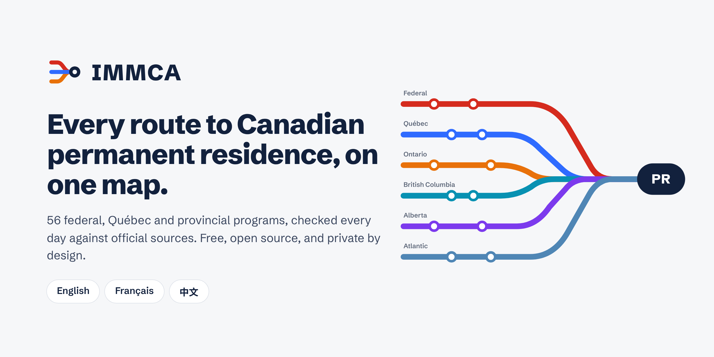
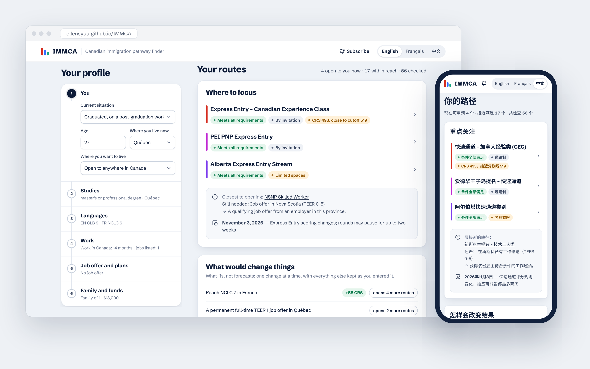
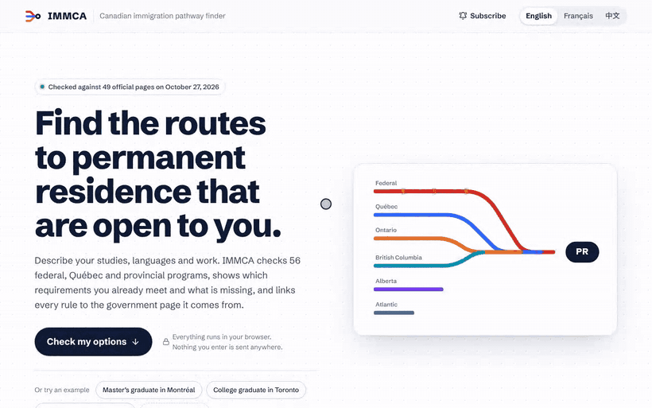
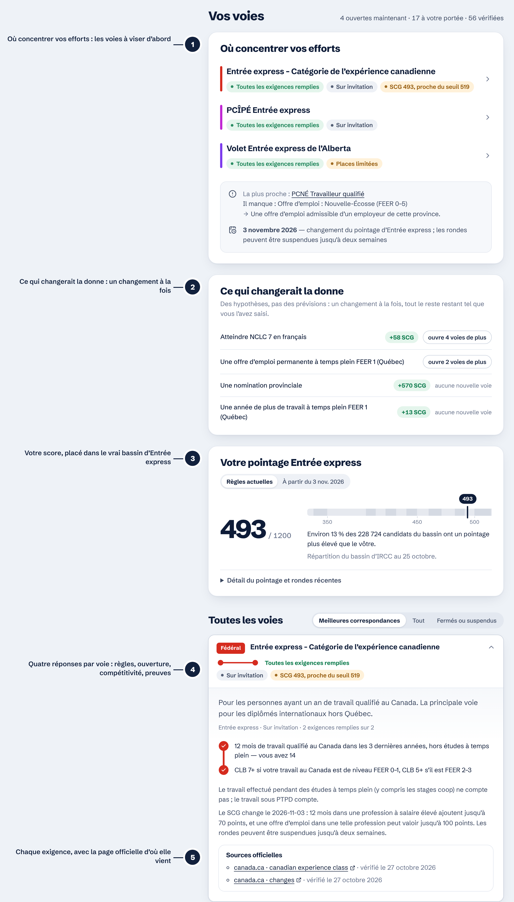

<a href="https://ellensyuu.github.io/IMMCA/">
  <picture>
    <source media="(prefers-color-scheme: dark)" srcset="../brand/cover-dark.png">
    
  </picture>
</a>

<h3>
  <a href="https://ellensyuu.github.io/IMMCA/">Ouvrir l’app</a>
   · 
  <a href="https://ellensyuu.github.io/IMMCA/#stay-updated">S’abonner</a>
   · 
  <a href="https://ellensyuu.github.io/IMMCA/#stay-updated">Installer</a>
   · 
  <a href="../research/">Sources</a>
   · 
  <a href="../../PRIVACY.md">Confidentialité</a>
</h3>

**Indiquez vos études, vos langues et votre expérience de travail. IMMCA vous dit quelles voies vers la résidence permanente vous sont ouvertes aujourd’hui, lesquelles sont à portée, et ce qui comblerait l’écart, chaque règle étant liée à sa page officielle.**

[English](../../README.md) · **Français** · [简体中文](README.zh-CN.md)

 

## Pourquoi IMMCA

Pour une personne étudiante étrangère, le plus difficile n’est pas une règle en particulier : c’est que les règles sont réparties entre **quatorze gouvernements** et changent tous les quelques mois. Entre 2024 et 2026, les points pour une offre d’emploi ont disparu d’Entrée express et reviennent sous une nouvelle forme le **3 novembre 2026** ; l’Ontario a fermé ses huit volets et les a remplacés par un seul ; la Colombie-Britannique, le Manitoba et la Saskatchewan ont fermé ou resserré leurs volets pour diplômés ; le Québec a aboli le PEQ, puis l’a rouvert pour quatre mois, jusqu’au **31 octobre 2026**.

- **Une carte au lieu de quatorze sites.** 56 programmes : Entrée express et toutes les catégories 2026, les projets pilotes atlantique, ruraux et francophones, le PSTQ et le PEQ du Québec, et les programmes des candidats de chaque province et territoire qui en a un.
- **Une réponse, pas une liste.** On commence par les voies à viser, l’exigence qui bloque la plus proche et les dates qui vous concernent.
- **Surveillé chaque jour, modifié après relecture.** Chaque matin, une action GitHub récupère les dernières rondes d’IRCC, relit les 49 pages officielles citées et redéploie le site. Une page modifiée est signalée sur le site et ouvre un ticket ; la règle n’est mise à jour qu’après relecture humaine et réussite des tests.
- **Honnête sur ses limites.** Chaque règle indique la solidité de ses preuves. Une exigence qu’un formulaire ne peut pas juger (recommandation d’une collectivité, permis d’un ordre) est affichée *à confirmer*, jamais comptée comme remplie.
- **Confidentiel par conception.** Tout se passe dans votre navigateur : ni compte, ni témoin, et rien de ce que vous saisissez n’est envoyé.
- **Dans votre langue.** English, Français et 中文, au choix en haut de la page, dans l’app et dans les calendriers.

## Démonstration

## Anatomie d’un résultat

1. **Où concentrer vos efforts** : les voies à viser d’abord, la plus proche qui ne vous est pas encore ouverte et ce qui lui manque, et la prochaine date qui vous concerne.
2. **Ce qui changerait la donne** : un changement à la fois (NCLC 7 en français, une année de travail de plus au Canada, une offre d’emploi, une nomination), avec le gain SCG *et* les voies qu’il ouvrirait.
3. **Votre score dans le vrai bassin** : votre SCG selon la grille actuelle et selon les règles du 3 novembre 2026, placé dans la distribution publiée par IRCC (228 724 candidats).
4. **Quatre réponses par voie**, gardées distinctes : *respectez-vous les règles*, le programme est-il *ouvert* (ou ses places 2026 presque épuisées), quelle est votre *compétitivité* lorsqu’un seuil officiel existe, et quelle est la *solidité des preuves*.
5. **Chaque exigence, avec sa source** : chaque programme est une ligne et chaque exigence une station, pleine si elle est remplie, vide sinon, en pointillé quand un formulaire ne peut pas en juger. Ouvrez-la pour voir comment combler l’écart et les pages officielles vérifiées.

## Fonctionnalités

| | |
|---|---|
| **Admissibilité** | 56 programmes fédéraux, québécois et provinciaux, classés ouverts / à portée / fermés |
| **Calcul du SCG** | Deux grilles selon la date, dont le nouveau facteur d’intégration au marché du travail (186 professions bien rémunérées) |
| **Estimation Arrima** | Score PSTQ selon la grille de 1 400 points du ministère |
| **Conversion des tests** | IELTS, CELPIP, PTE Core, TEF Canada (deux échelles) et TCF Canada vers NCLC/CLB |
| **Abonnement calendrier** | Apple Calendar, Google Agenda, Outlook : chaque ronde, échéance (rappel 3 jours avant) et changement de règle, ou un résumé quotidien ; aussi en RSS/Atom |
| **App installable** | iPhone, Android, Mac et Windows depuis le navigateur : plein écran, hors ligne |
| **Mise à jour quotidienne** | Flux IRCC, surveillance des pages officielles, redéploiement automatique |
| **Statistiques ouvertes** | Visites, abonnements et installations comptés par le compteur libre d’IMMCA, publiés chaque jour dans [`stats/`](../../stats/) |

Pour les détails techniques (fonctionnement, règles en données, exécution, structure), voir le [README en anglais](../../README.md#how-it-works).

## Confidentialité

Rien de ce que vous saisissez ne quitte votre appareil : le calcul se fait dans le navigateur et votre profil reste dans son stockage local. Ni compte, ni témoin. L’utilisation est comptée de façon anonyme, sans adresse IP ; voir [PRIVACY.md](../../PRIVACY.md).

## Avertissement

IMMCA est un outil indépendant et libre. Ce n’est pas un avis juridique, et il n’est affilié ni à IRCC, ni au ministère de l’Immigration du Québec, ni à aucun gouvernement provincial. Remplir les exigences minimales ne garantit pas une invitation, et les règles changent souvent. Vérifiez toujours la page officielle et consultez au besoin un consultant réglementé (CRIC) ou un avocat.

## Licence

[Apache License 2.0](../../LICENSE). Pour citer le projet : [CITATION.cff](../../CITATION.cff).
