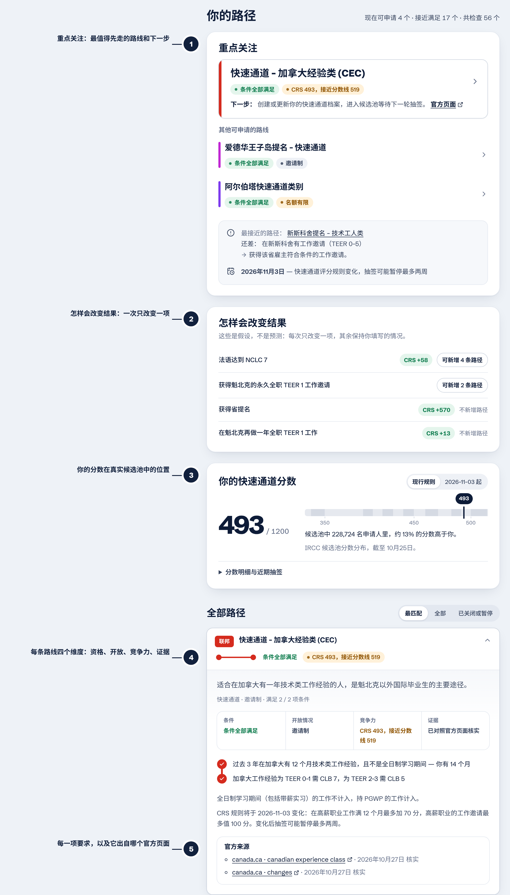

<a href="https://ellensyuu.github.io/IMMCA/">
  <picture>
    <source media="(prefers-color-scheme: dark)" srcset="../brand/cover-dark.png">
    
  </picture>
</a>

<h3>
  <a href="https://ellensyuu.github.io/IMMCA/">打开应用</a>
   · 
  <a href="https://ellensyuu.github.io/IMMCA/#stay-updated">订阅提醒</a>
   · 
  <a href="https://ellensyuu.github.io/IMMCA/#stay-updated">安装 App</a>
   · 
  <a href="../research/">证据记录</a>
   · 
  <a href="../../PRIVACY.md">隐私</a>
</h3>

**填写你的学历、语言和工作经历，IMMCA 会告诉你：哪些加拿大永居路线现在就能申请，哪些差一点， 以及补上哪一项最关键。每一条规则都链接到它出自的政府官方页面。**

[English](../../README.md) · [Français](README.fr.md) · **简体中文**

 

## 为什么做 IMMCA

对国际学生来说，规划永居最难的不是某一条规则，而是规则分散在**十四个政府**，而且每隔几个月就变。仅 2024 到 2026 年间：快速通道取消了工作邀请加分，又将在 **2026 年 11 月 3 日**以新形式回归；安大略关闭全部八个省提名类别，合并为一个；BC、曼省、萨省关闭或收紧了毕业生类别；魁北克取消 PEQ，又重开了一个在 **2026 年 10 月 31 日**截止的四个月窗口。

- **一张地图代替十四个网站。** 覆盖 56 个项目：快速通道及 2026 年全部类别抽签、大西洋/乡村/法语社区试点、魁北克 PSTQ 与 PEQ，以及所有设有省提名的省和地区。
- **直接给答案，而不是一张清单。** 先告诉你重点关注哪几条路线、离你最近的那条还差什么、哪些日期和你有关。
- **每天监测，人工审核后才改规则。** GitHub Action 每天早上读取 IRCC 最新抽签、重新检查规则引用的 49 个官方页面并重新部署网站。页面一旦变化，网站上会标出并自动开一个 issue；规则本身要经人工读过变化、测试通过后才会更新。
- **对不确定的地方坦白。** 每条规则都标明证据可靠程度。表格无法判断的条件（如社区推荐信、执业执照）显示为“待确认”，不会被算作已满足。
- **隐私优先。** 全部在你的浏览器里运行：没有账户、没有 Cookie，你输入的内容不会发送到任何地方。
- **三种语言。** English、Français、中文，可在页面顶部切换，App 和日历订阅也一样。

## 演示

## 结果页解析

1. **重点关注**：最值得先走的一条路线和下一步、其他可申请的路线、离你最近但还没开放的路线还差什么，以及下一个和你有关的日期。
2. **怎样会改变结果**：一次只改变一项（法语 NCLC 7、多一年加拿大工作经验、工作邀请、省提名），同时显示 CRS 变化*和*会新开放的路线。
3. **你在真实候选池中的位置**：按现行规则和 2026 年 11 月 3 日新规则分别计算 CRS，并放进 IRCC 公布的 228,724 名候选人分布中。
4. **每条路线四个维度**，分开显示而不是混成一个绿灯：是否*满足条件*、项目是否*开放*（或 2026 年名额是否快用完）、在有官方分数线时的*竞争力*，以及*证据*是否可靠。
5. **每一项要求都有出处**：每个项目是一条地铁线，每项要求是一个站点：满足为实心，不满足为空心，表格无法判断的为虚线。展开即可看到如何补上差距，以及核实所依据的官方页面。

## 功能

| | |
|---|---|
| **快速评估或完整资料** | 9 个问题先给出初步结果并说明假设；完整资料可填写准确考试分数、每份工作、工作邀请和家庭情况 |
| **资格筛选** | 56 个联邦、魁北克和省级项目，分为可申请 / 接近满足 / 已关闭 |
| **CRS 计算** | 两套规则按日期切换，包括新的劳动力市场融合加分和 186 个高薪职业 |
| **Arrima 估分** | 按魁北克移民部 1,400 分制估算 PSTQ 分数 |
| **语言成绩换算** | 雅思、思培、PTE Core、TEF Canada（新旧两种计分）和 TCF Canada 换算为 CLB/NCLC |
| **日历订阅** | Apple 日历、Google 日历、Outlook：每次新抽签、截止日期（提前 3 天提醒）和规则变化，或每日摘要；也提供 RSS/Atom |
| **可安装 App** | iPhone、Android、Mac、Windows 均可直接从浏览器安装，全屏、可离线使用 |
| **每日自动更新** | 刷新 IRCC 数据、监测官方页面文字变化、自动重新部署 |
| **公开的使用统计** | 访问、订阅和安装次数由 IMMCA 自己的开源计数器统计，每日公开在 [`stats/`](../../stats/) |

技术细节（工作原理、规则数据结构、运行方式、目录结构）请见 [英文 README](../../README.md#how-it-works)。

## 隐私

你输入的内容不会离开你的设备：所有计算都在浏览器里完成，资料只保存在本机存储中，清除网站数据即可删除。没有账户，没有 Cookie。使用次数由开源计数器匿名统计，不保存 IP 地址，详见 [PRIVACY.md](../../PRIVACY.md)。

## 免责声明

IMMCA 是独立的开源筛选工具，不构成法律意见，与加拿大移民部（IRCC）、魁北克移民部或任何省政府均无关联。满足最低条件并不保证获得邀请，规则也经常变化。请务必以官方页面为准，并可就个人情况咨询持牌移民顾问（RCIC）或律师。

## 许可

[Apache License 2.0](../../LICENSE)。如使用本项目的规则引擎或数据，请按 [CITATION.cff](../../CITATION.cff) 引用。
